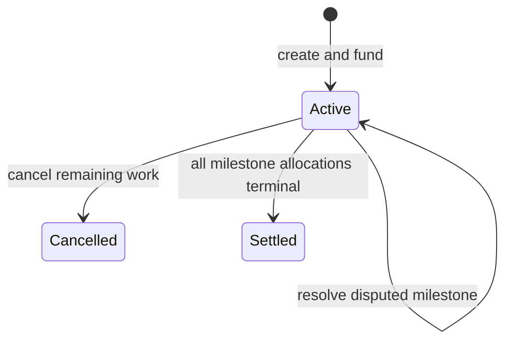
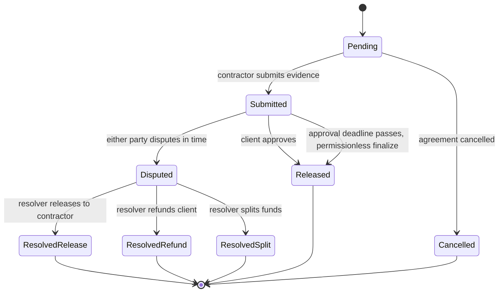

# SafePay Architecture

## Purpose and scope

SafePay is a consumer-facing, milestone-based escrow. A client defines an agreement and funds it; a contractor submits work evidence; approved or undisputed milestones pay out; and unresolved disputes keep the affected funds locked until a resolver decides their allocation.

This document describes a proposed design, not deployed behavior. No Monad deployment, token, resolver, sponsor integration, or automated transaction service is assumed to exist.

## Contract architecture

### Escrow ledger

Use a non-upgradeable `Escrow` contract as the sole custodian and source of truth. It stores agreements in an ID-keyed mapping and keeps each agreement's accounting separate. There is no owner withdrawal function, rescue path for escrow assets, or privileged bypass. No proxy or upgrade administrator can change the rules after funds are deposited.

The contract exposes narrow operations:

- `createAndFund`: the client supplies the contractor, supported token, milestones, approval window, dispute window, and client cancellation fee. Validate all terms and transfer the exact sum from the client in the same transaction. If validation or transfer fails, the entire operation reverts and no agreement is created. A UI may prepare a draft first, but only a successful onchain call creates a funded agreement.
- `submitMilestone`: only the contractor can submit evidence for a pending milestone.
- `approveMilestone`: only the client can approve a submitted milestone before its approval deadline and before a dispute.
- `finalizeMilestone`: any address may trigger auto-release after the approval deadline if the milestone remains undisputed. The caller receives no funds or special authority.
- `raiseDispute`: either participant may dispute an unreleased submitted milestone within its dispute window.
- `resolveDispute`: only the agreement's preselected resolver may settle that disputed milestone, using one of three outcomes: release to contractor, refund to client, or split between them.
- `cancelAgreement`: either participant may cancel remaining work under the immutable cancellation terms, subject to the outstanding-submission and open-dispute restrictions below.

All token transfers use OpenZeppelin `SafeERC20`; externally callable fund-moving methods use `ReentrancyGuard`. Validate state and amounts, update accounting before external calls, and emit an event for every state change. Custom errors and NatSpec document invalid transitions and public interfaces.

Support only reviewed, explicitly configured ERC-20 tokens with reliable transfer semantics. Reject fee-on-transfer or rebasing behavior unless accounting is deliberately designed and tested for it. Token configuration must not give an administrator a way to move or redirect existing escrow funds. **[External verification required: supported token addresses, decimals, transfer behavior, and availability on the target Monad network.]**

Descriptions and evidence should be bound to immutable content identifiers (for example, a content hash plus URI), rather than relying on mutable web content. The contract stores amounts, hashes/URIs, participants, deadlines, and outcomes; large descriptions and evidence remain offchain. **[External verification required: storage durability, URI availability, privacy, and whether sensitive evidence must be encrypted or access-controlled.]**

### Accounting rules

- The total of all milestone amounts must be nonzero and exactly equal the amount funded at creation. All milestones use the agreement's one token.
- A milestone's allocation is terminal after release, refund, split, or cancellation. It can never be paid twice.
- Funds for a disputed milestone remain in escrow until its resolver outcome is executed. The resolver can allocate only that milestone's remaining amount.
- A split specifies the contractor's share in token base units; the client receives the exact remainder. A split must give both parties a positive amount.
- Completed payouts are final and cannot be clawed back by cancellation or a later dispute.
- A client cancellation fee is paid to the contractor from the agreement's remaining unallocated balance, capped at that balance. The remainder is refunded to the client. Contractor cancellation incurs no client fee. Neither cancellation path touches already released milestones.
- **[External verification required: confirm the cancellation-fee recipient, cap, enforceability, and user-facing disclosure before funding.]**
- Cancellation is rejected while any milestone is submitted but unresolved or any dispute is open. Resolve or release outstanding submissions first; cancellation then closes pending milestones and distributes the remaining balance by the agreed rules.

The contract must maintain a per-agreement liability ledger and ensure actual token balances cover all outstanding liabilities. There is no generic `withdraw`, arbitrary recipient transfer, or resolver-controlled destination.

## State machine

An agreement is created and funded atomically, so there is no onchain unfunded state. Agreement status is `Active`, `Cancelled`, or `Settled`; dispute status is tracked on each milestone so unrelated milestones can proceed while disputed funds remain locked.

Milestone transitions:

### Time and dispute behavior

Each agreement snapshots its approval and dispute windows at creation. The approval window defaults to 72 hours. On submission, record `submittedAt`, `approvalDeadline = submittedAt + approvalWindow`, and `disputeDeadline = submittedAt + disputeWindow`.

Either participant can dispute while the milestone is submitted, unreleased, and before its dispute deadline. An explicit client approval releases immediately and closes the opportunity to dispute that milestone. If no dispute is open and no approval arrives, the milestone becomes eligible for permissionless auto-release at the approval deadline. Disputing before release pauses that milestone's payout; only the resolver may then allocate its funds. Other undisputed milestones may continue.

Smart contracts do not wake themselves up at a deadline. `finalizeMilestone` makes release permissionless once the deadline passes, but an onchain transaction still has to call it. A relayer or scheduled service may prompt that call but is not trusted to decide whether release is allowed. **[External verification required: whether the product will provide a relayer, who pays gas, and what “automatic” release promises in the UI.]**

The interaction between approval and dispute windows is a product policy: the dispute deadline limits when a dispute may be opened, while the approval deadline controls auto-release. Explicit approval releases sooner. **[External verification required: validate these timing semantics with users, counsel, and the selected resolver before deployment.]**

## Data model

### Agreement

| Field | Meaning |
| --- | --- |
| `agreementId` | Unique monotonically assigned identifier |
| `client` / `contractor` | Fixed participant addresses |
| `token` | Supported ERC-20 used for all milestones |
| `totalAmount` | Exact sum funded by the client |
| `milestones[]` | Ordered milestone records and amounts |
| `approvalWindow` / `disputeWindow` | Immutable durations in seconds |
| `clientCancellationFee` | Immutable token amount, capped by remaining balance at cancellation |
| `resolver` | Fixed address authorized only for the three dispute outcomes |
| `status` | `Active`, `Cancelled`, or `Settled` |
| `createdAt` / `fundedAt` | Creation and funding timestamps; equal for atomic create-and-fund |
| `releasedTotal` / `refundedTotal` | Accounting totals used to check liabilities |

The resolver is specified before funding and cannot be replaced while an agreement is active. **[External verification required: resolver identity, availability, conflict policy, and whether a multisig or other adjudication process is appropriate.]**

### Milestone

| Field | Meaning |
| --- | --- |
| `amount` | Fixed token amount allocated to this milestone |
| `descriptionHash` / `descriptionURI` | Integrity reference for the agreed description |
| `status` | `Pending`, `Submitted`, `Disputed`, terminal release/refund/split, or `Cancelled` |
| `evidenceHash` / `evidenceURI` | Contractor's submission evidence reference |
| `submittedAt` | Timestamp used to derive both deadlines |
| `approvalDeadline` / `disputeDeadline` | Fixed deadlines for this submission |
| `disputeRaisedBy` / `disputeReasonHash` | Optional dispute record |
| `contractorPayout` / `clientRefund` | Final allocation for a split or resolver outcome |

Every field that can affect rights or fund movement is fixed onchain or committed by a hash. Avoid placing personal data or private evidence directly onchain.

## Security model

### Authority and trust boundaries

- **Client:** funds the full agreement, approves submitted milestones, and may cancel under the agreed fee rules.
- **Contractor:** submits evidence and may cancel under the agreed rules.
- **Resolver:** can act only on an open dispute and only release, refund, or split the disputed milestone's remaining amount. The resolver cannot withdraw, redirect funds, change agreement terms, replace itself, or act on undisputed funds.
- **Arbitrary caller:** may trigger an eligible auto-release. The caller cannot choose the recipient or amount.
- **Frontend, AI, relayer, and storage provider:** untrusted helpers. None can change contract state without an authorized transaction; AI can propose terms but never sign, submit, or move funds.

There is no privileged owner or emergency withdrawal route. Do not add hidden owner backdoors. Any future pause mechanism must not enable confiscation, redirection, or withdrawal of escrowed funds and requires a separately reviewed threat model.

### Required defenses

- Validate nonzero/distinct participants, nonzero supported token, nonzero resolver, valid windows, nonempty milestones, each positive milestone amount, and exact milestone-total equality before accepting funds.
- Restrict submission, approval, dispute, resolution, finalization, and cancellation to their documented actor, state, and deadline.
- Apply checks-effects-interactions and reentrancy protection to all token movement; use SafeERC20 and verify exact funded amounts for supported token behavior.
- Enforce single terminal allocation per milestone and verify agreement-wide accounting against token liabilities.
- Do not allow dispute resolution to bypass the three outcomes or expand beyond the disputed milestone balance.
- Treat all UI reads, RPC responses, timestamps, URIs, and AI-generated suggestions as untrusted until checked against contract state and user intent.
- Never fabricate transactions, addresses, network status, or sponsor integrations. Clearly label mock/demo-only data; never present it as a real payment.

## Frontend pages

Use rupees and plain language throughout the consumer experience. Explain that the agreement uses a selected payment token only where necessary; do not make crypto jargon the primary language. If showing a rupee estimate for a token amount, label it as an estimate and identify the verified rate and timestamp. **[External verification required: rupee conversion source, refresh policy, and any legal or compliance disclosures.]**

1. **Home and agreements:** active, awaiting review, disputed, completed, and cancelled agreements; clear next action and amount in rupees.
2. **Create agreement:** contractor, supported payment token, milestone descriptions and amounts, approval window (72-hour default), dispute window, cancellation fee, and resolver. Show milestone total and full terms before the client funds.
3. **Review and fund:** human-readable summary, exact token total, allowance/funding request, network confirmation, and clear success/failure states. Never show a transaction as complete until verified from chain data.
4. **Agreement detail:** parties, agreed terms, milestone timeline, released and remaining balances, deadlines, evidence links, cancellation action, and dispute state. Hide actions not currently permitted.
5. **Contractor submission:** select a pending milestone, attach or link evidence, show what will be shared, and submit its integrity reference.
6. **Client review:** inspect milestone terms and evidence; approve or raise a dispute with a reason before the applicable deadline.
7. **Dispute resolution:** show both parties' submissions, disputed amount, resolver identity, and a read-only outcome record. Only the resolver wallet can submit one of the three allowed outcomes.
8. **Activity and transaction detail:** verified event history and links only to a configured, verified network explorer. Clearly distinguish pending, confirmed, failed, and demo-only activity.

AI may draft milestone wording or suggest payment rules, but the user must review and explicitly submit the terms. AI is not an approver, resolver, signer, or transaction executor.

## Testing strategy

### Contract tests (Foundry)

- Creation: valid agreement, exact funding, unsupported tokens, invalid participants/windows, zero amounts, empty milestones, and totals below or above the funded amount.
- Roles and transitions: nonparticipant submission/approval/cancellation, noncontractor evidence submission, nonclient approval, nonresolver resolution, and every invalid or repeated transition.
- Time boundaries: immediately before, at, and after approval/dispute deadlines; approval before deadline; permissionless finalize only after deadline; no finalize while disputed.
- Disputes: either party may raise in-window, cannot dispute after release/deadline, disputed funds remain escrowed, and only release/refund/split outcomes succeed for exactly the disputed balance.
- Cancellation: client fee paid only from remaining funds and capped at remaining balance; contractor cancellation has no client fee; prior releases remain untouched; cancellation blocked with unresolved submission or open dispute.
- Token adversaries: transfer failure, false return, reentrancy attempt, fee-on-transfer, and unsupported token behavior. Test only token behaviors that the supported-token policy claims to handle.
- Invariants and fuzzing: no milestone pays twice; no agreement pays more than funded; token liabilities never exceed contract balances; disputed amounts cannot leave escrow except through resolver outcome; resolver and arbitrary callers cannot withdraw or redirect funds.

### Frontend and end-to-end tests

- Test form validation, exact milestone totals, default and custom windows, readable rupee formatting, and clear confirmation before funding.
- Test UI permissions and state from contract events/state rather than local optimistic assumptions; verify pending, failed, and confirmed transaction behavior.
- Cover evidence submission, approval, auto-release prompting, dispute opening, resolver-only controls, both cancellation paths, and completed-milestone history.
- Verify all demo fixtures are visibly labeled and cannot be mistaken for live network activity. Test mobile layouts, keyboard navigation, and accessible status announcements for deadlines and errors.

### Network and release checks

Before any live deployment, verify the Monad chain configuration, RPC and confirmation/finality behavior, supported token contracts and decimals, explorer links, resolver operations, and relayer assumptions. Run tests against the target network or an approved fork where practical; publish only deployment addresses and integration claims that are independently verified. **[External verification required: all chain, token, resolver, storage, pricing, and legal assumptions listed above.]**